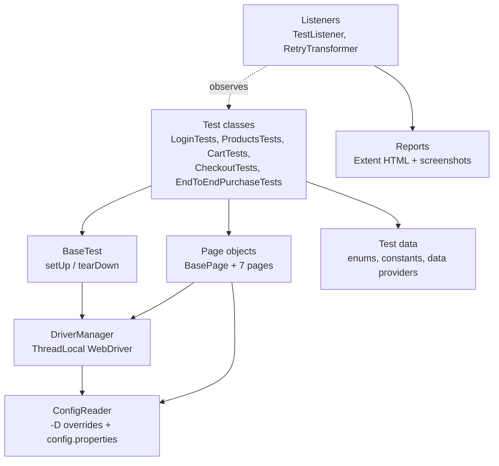
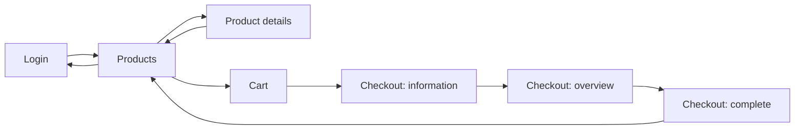

# E-Commerce UI Test Automation Framework

[](https://github.com/RB-projects-15/ecommerce-selenium-automation/actions/workflows/maven-tests.yml)


A UI regression and smoke test framework for the public demo shop [SauceDemo](https://www.saucedemo.com/), written in **Java 21 with Selenium WebDriver, TestNG and Maven** using the **Page Object Model**. It covers the complete shopper journey: authentication, product catalogue, cart, checkout and end-to-end purchase.

The framework runs tests in parallel on Chrome, Firefox or Edge, retries one-off failures, produces an HTML report with failure screenshots, and runs automatically in **GitHub Actions** on every push, pull request and weekday night.

---

## Table of contents

1. [Highlights](#highlights)
2. [Tech stack](#tech-stack)
3. [Test strategy](#test-strategy)
4. [Test catalogue](#test-catalogue)
5. [Architecture](#architecture)
6. [Project structure](#project-structure)
7. [Getting started](#getting-started)
8. [Running the tests](#running-the-tests)
9. [Configuration](#configuration)
10. [Reporting](#reporting)
11. [CI/CD pipeline](#cicd-pipeline)
12. [Stability and flakiness control](#stability-and-flakiness-control)
13. [Design decisions](#design-decisions)
14. [Extending the framework](#extending-the-framework)
15. [Troubleshooting](#troubleshooting)
16. [Scope, assumptions and limitations](#scope-assumptions-and-limitations)
17. [Roadmap](#roadmap)

---

## Highlights

| Area           | What it delivers                                                                                                                    |
| -------------- | ----------------------------------------------------------------------------------------------------------------------------------- |
| **Coverage**   | 43 automated test executions across 5 feature classes: login, product catalogue, cart, checkout and end-to-end purchase             |
| **Design**     | Page Object Model with a shared `BasePage` and fluent navigation, where every action returns the next page object                   |
| **Execution**  | Parallel by method (one browser per test) using a thread-safe `ThreadLocal` driver; smoke and full regression suites                |
| **Browsers**   | Chrome, Firefox and Edge, selectable with `-Dbrowser=`; headless mode with `-Dheadless=true`                                        |
| **Data**       | Typed test data (enums) and TestNG data providers for the data-driven scenarios                                                     |
| **Reporting**  | ExtentReports HTML report with step logs, group categories and failure screenshots embedded in the report                           |
| **Resilience** | Explicit waits only (no `Thread.sleep`), self-verifying page objects, JavaScript click fallback and configurable automatic retry    |
| **CI/CD**      | GitHub Actions: headless run on push and pull request, nightly schedule, manual run with suite and browser choice, report artifacts |

## Tech stack

| Area                            | Tool                                                               | Version |
| ------------------------------- | ------------------------------------------------------------------ | ------- |
| Language                        | Java                                                               | 21      |
| Browser automation              | Selenium WebDriver (Selenium Manager resolves the browser drivers) | 4.38.0  |
| Test framework                  | TestNG                                                             | 7.11.0  |
| Build and dependency management | Maven                                                              | 3.9+    |
| Test execution                  | Maven Surefire Plugin                                              | 3.5.4   |
| Reporting                       | ExtentReports (Spark reporter) plus TestNG/Surefire reports        | 5.1.2   |
| CI                              | GitHub Actions on `ubuntu-24.04` with Temurin JDK 21               | n/a     |

## Test strategy

**Application under test:** [SauceDemo](https://www.saucedemo.com/), a public e-commerce demo with six products, a cart and a three-step checkout.

**Objective:** give fast, reliable feedback that the core purchase journey works and that invalid input and unauthorised access are handled correctly.

**Test levels and types**

| Type        | Purpose                                                                                          | Where                   |
| ----------- | ------------------------------------------------------------------------------------------------ | ----------------------- |
| Smoke       | Quick health check of the critical path (6 tests)                                                | group `smoke`           |
| Regression  | Full functional coverage of every feature area                                                   | group `regression`      |
| Negative    | Invalid credentials, locked-out user, missing checkout details, access without login             | group `negative`        |
| End-to-end  | Login, add to cart, checkout and confirmation in one flow                                        | `EndToEndPurchaseTests` |
| Data-driven | One test body run against several inputs (credentials, sort options, products, checkout details) | TestNG data providers   |

**Test design techniques used:** positive and negative testing, equivalence partitioning of invalid inputs (wrong password, unknown user, empty fields), error guessing (SQL-style input), state-based testing (cart contents across navigation), and calculation verification (item total, tax and grand total).

**Entry and exit criteria:** run the smoke suite first and run the full regression once it passes. A run is green when every test passes within the configured retries; failed attempts stay visible in the report.

## Test catalogue

Groups are shown as **S** (smoke), **R** (regression) and **N** (negative). All 43 executions come from 27 test methods; data-driven methods run once per data row.

### Login: `LoginTests` (11 executions)

| ID             | Test method                                       | What it verifies                                                                                                           | Groups |
| -------------- | ------------------------------------------------- | -------------------------------------------------------------------------------------------------------------------------- | ------ |
| LG-01          | `verifyStandardUserCanLogIn`                      | A valid user lands on the Products page                                                                                    | S, R   |
| LG-02 to LG-07 | `verifyLoginFailsWithInvalidCredentials` (6 rows) | Correct error and no access for: wrong password, unknown user, SQL-style input, empty username, empty password, both empty | R, N   |
| LG-08          | `verifyLockedOutUserCannotLogIn`                  | `locked_out_user` is rejected with the locked-out message                                                                  | R, N   |
| LG-09          | `verifyInventoryIsNotAccessibleWithoutLogin`      | Opening `/inventory.html` directly shows the login page with an access error                                               | R, N   |
| LG-10          | `verifyUserCanLogOut`                             | Logout via the side menu returns to the login form                                                                         | S, R   |
| LG-11          | `verifyPasswordFieldIsMasked`                     | The password input is of type `password`                                                                                   | R      |

### Product catalogue: `ProductsTests` (13 executions)

| ID             | Test method                                   | What it verifies                                                            | Groups |
| -------------- | --------------------------------------------- | --------------------------------------------------------------------------- | ------ |
| PR-01          | `verifyProductsPageLayout`                    | Title, all 6 products and the sort dropdown are shown                       | S, R   |
| PR-02          | `verifyAllProductsAreListedWithCorrectPrices` | Every catalogue product appears with the expected price                     | R      |
| PR-03 to PR-06 | `verifyProductSorting` (4 rows)               | Name A to Z, Name Z to A, Price low to high, Price high to low              | R      |
| PR-07 to PR-12 | `verifyProductDetails` (6 rows)               | Details page shows the right name, price and a description for each product | R      |
| PR-13          | `verifyBackToProductsFromDetails`             | Back button returns to the full product list                                | R      |

### Cart: `CartTests` (9 executions)

| ID    | Test method                                 | What it verifies                                                 | Groups |
| ----- | ------------------------------------------- | ---------------------------------------------------------------- | ------ |
| CT-01 | `verifyCartIsEmptyOnFreshLogin`             | New session has no badge and no cart items                       | R      |
| CT-02 | `verifyProductCanBeAddedToCart`             | Badge shows 1; cart has the right name, price and quantity       | S, R   |
| CT-03 | `verifyMultipleProductsCanBeAdded`          | Badge shows 3; cart contains exactly the three chosen products   | R      |
| CT-04 | `verifyProductCanBeRemovedFromCartPage`     | Removing on the cart page empties the cart and clears the badge  | S, R   |
| CT-05 | `verifyProductCanBeRemovedFromProductsPage` | Add then remove on the Products page clears the badge            | R      |
| CT-06 | `verifyContinueShoppingReturnsToProducts`   | Continue Shopping returns to the Products page                   | R      |
| CT-07 | `verifyCartPersistsWhileNavigating`         | Cart keeps its item after visiting a details page and going back | R      |
| CT-08 | `verifyProductCanBeAddedFromDetailsPage`    | Adding from the details page updates the badge and cart          | R      |
| CT-09 | `verifyResetAppStateClearsCart`             | Side menu "Reset App State" empties the cart                     | R      |

### Checkout: `CheckoutTests` (8 executions)

| ID             | Test method                                  | What it verifies                                                                                                   | Groups |
| -------------- | -------------------------------------------- | ------------------------------------------------------------------------------------------------------------------ | ------ |
| CO-01 to CO-04 | `verifyCheckoutFormValidation` (4 rows)      | Required-field errors for missing first name, last name, postal code, and all fields empty; user stays on step one | R, N   |
| CO-05          | `verifyCancelOnInformationPageReturnsToCart` | Cancel returns to the cart with items intact                                                                       | R      |
| CO-06          | `verifyOverviewListsSelectedProducts`        | Order overview lists the chosen products                                                                           | R      |
| CO-07          | `verifyOrderSummaryCalculations`             | Item total equals the sum of product prices; total equals item total plus tax                                      | R      |
| CO-08          | `verifyCancelOnOverviewReturnsToProducts`    | Cancel on the overview returns to the Products page                                                                | R      |

### End-to-end: `EndToEndPurchaseTests` (2 executions)

| ID     | Test method                                        | What it verifies                                                               | Groups |
| ------ | -------------------------------------------------- | ------------------------------------------------------------------------------ | ------ |
| E2E-01 | `verifyCompletePurchaseWorkflow`                   | Login, add two products, checkout, confirmation message, empty cart, Back Home | S, R   |
| E2E-02 | `verifyPurchaseOfMostExpensiveProductAfterSorting` | Sort by price descending, buy the top product, see confirmation                | R      |

## Architecture

The framework is layered so that tests describe _what_ is verified, page objects know _how_ to drive the UI, and infrastructure code is kept out of both.



**Page flow** (each arrow is a method that returns the next page object):



**Lifecycle of one test:** TestNG starts the test, `TestListener` creates its report entry, `BaseTest.setUp` creates a browser for the current thread, the test drives page objects, and `BaseTest.tearDown` quits the browser. On failure the listener captures a screenshot first, and the retry analyzer may re-run the test.

## Project structure

```
ecommerce-selenium-automation/
├── pom.xml                              # dependencies (all test scope), compiler and surefire config
├── testng.xml                           # full regression suite, parallel by method
├── testng-smoke.xml                     # smoke suite (group "smoke")
├── .github/workflows/maven-tests.yml    # CI pipeline
├── .gitattributes                       # consistent line endings
├── .gitignore
└── src/test
    ├── java/com/qa/automation
    │   ├── base/        BaseTest, TestGroups
    │   ├── config/      ConfigReader
    │   ├── driver/      DriverManager
    │   ├── pages/       BasePage, LoginPage, ProductsPage, ProductDetailsPage, CartPage,
    │   │                CheckoutInformationPage, CheckoutOverviewPage, CheckoutCompletePage
    │   ├── data/        Product, User, SortOption, TestData,
    │   │                LoginDataProvider, ProductDataProvider, CheckoutDataProvider
    │   ├── listeners/   TestListener, RetryAnalyzer, RetryTransformer
    │   ├── utils/       ExtentReportManager, ScreenshotUtils, PriceParser, XPaths
    │   └── tests/       LoginTests, ProductsTests, CartTests, CheckoutTests, EndToEndPurchaseTests
    └── resources
        ├── config.properties
        └── META-INF/services/org.testng.ITestNGListener   # auto-registers the listeners
```

| Component                            | Responsibility                                                                                                |
| ------------------------------------ | ------------------------------------------------------------------------------------------------------------- |
| `BaseTest`                           | Creates and quits the browser around every test; offers `openLoginPage()` and `loginAsStandardUser()` helpers |
| `DriverManager`                      | One `WebDriver` per thread; Chrome, Firefox and Edge options; headless mode; password-manager popups disabled |
| `ConfigReader`                       | Reads settings: command-line `-D` property first, then `config.properties`                                    |
| `BasePage`                           | Explicit waits, click with JavaScript fallback, typing, text and visibility helpers, cart badge count         |
| Page classes                         | Locators and user actions for one page each; the constructor waits until the page has really loaded           |
| `Product`, `User`, `SortOption`      | Typed test data: expected names and prices live in one place                                                  |
| `TestListener`                       | Builds the Extent report, attaches failure screenshots, logs retried attempts                                 |
| `RetryTransformer` / `RetryAnalyzer` | Apply a retry policy to every test without annotating each one                                                |
| `PriceParser`, `XPaths`              | Small helpers for parsing prices such as `Item total: $29.99` and for safe XPath building                     |

## Getting started

**Prerequisites**

- JDK 21 (`java -version`)
- Maven 3.9 or newer (`mvn -version`)
- Google Chrome, Firefox or Edge installed. No manual driver download is needed because Selenium Manager fetches the matching driver.
- Internet access to `https://www.saucedemo.com/`

**Setup**

```bash
git clone https://github.com/RB-projects-15/ecommerce-selenium-automation.git
cd ecommerce-selenium-automation
mvn clean test
```

The first run downloads dependencies and the browser driver, so it takes longer than later runs.

## Running the tests

```bash
mvn clean test                                   # full regression, Chrome, visible browser
mvn clean test -DsuiteXmlFile=testng-smoke.xml   # smoke suite only
mvn clean test -Dheadless=true                   # headless (what CI uses)
mvn clean test -Dbrowser=firefox                 # chrome | firefox | edge
mvn clean test -DretryCount=0                    # disable retries while debugging
mvn clean test -Dtest=LoginTests                 # a single class (runs it directly, ignoring the suite file)
mvn clean test -Dtest=CartTests#verifyProductCanBeAddedToCart   # a single method
```

Options can be combined, for example `mvn clean test -Dheadless=true -Dbrowser=firefox -DsuiteXmlFile=testng-smoke.xml`.

> **Windows PowerShell:** quote any `-D` argument that contains a dot, otherwise PowerShell splits it and Maven fails with _Unknown lifecycle phase ".xml"_:
> `mvn clean test "-DsuiteXmlFile=testng-smoke.xml"`
> (or `mvn --% clean test -DsuiteXmlFile=testng-smoke.xml`). Command Prompt, Git Bash, Linux and macOS do not need quotes.

**Execution model:** the suite files use `parallel="methods"` with 3 threads, so up to three browsers run at the same time. Data-driven tests also run their rows in parallel. To change the thread count, edit `thread-count` in `testng.xml` and `testng-smoke.xml`.

## Configuration

Defaults are in `src/test/resources/config.properties`. **Any key can be overridden with `-Dkey=value`**, and the command line always wins.

| Key            | Default                      | Description                                                            |
| -------------- | ---------------------------- | ---------------------------------------------------------------------- |
| `browser`      | `chrome`                     | `chrome`, `firefox` or `edge`                                          |
| `headless`     | `false`                      | Run without a visible browser window                                   |
| `baseUrl`      | `https://www.saucedemo.com/` | Application under test                                                 |
| `explicitWait` | `10`                         | Explicit wait timeout in seconds                                       |
| `retryCount`   | `1`                          | How many times a failed test is re-run before it is reported as failed |

Other settings: the page-load timeout is 30 seconds, and the suite parallelism is defined in the suite XML files.

## Reporting

After a run, results are in `target/`:

| Output                        | Location                                 | Contents                                                                                              |
| ----------------------------- | ---------------------------------------- | ----------------------------------------------------------------------------------------------------- |
| **Extent HTML report**        | `target/extent-report/ExtentReport.html` | Dashboard, per-test steps, group categories, environment info, failure screenshots embedded as Base64 |
| **Failure screenshots**       | `target/screenshots/`                    | PNG named `<test>_<timestamp>.png`                                                                    |
| **TestNG / Surefire reports** | `target/surefire-reports/`               | XML and text results used by CI tools                                                                 |

Open `ExtentReport.html` directly in a browser. Because screenshots are embedded, the report stays complete after being downloaded from CI or sent by email.

**What the report shows**

- One entry per test execution, named `Class - method [parameters]`, so each data row is visible separately.
- Steps such as `Click By.id: login-button`. Typed values are not logged, so no credentials appear in the report.
- Groups (`smoke`, `regression`, `negative`) as filterable categories.
- Environment details: application, base URL, browser, headless flag, OS and Java version.
- Retried tests: the failed attempt is recorded with its screenshot and marked as retried, then the next attempt appears as its own entry.

`mvn clean` removes the whole `target/` folder, so every run starts with fresh reports.

## CI/CD pipeline

Workflow: `.github/workflows/maven-tests.yml`

| Trigger                   | When                                                                                                                                        |
| ------------------------- | ------------------------------------------------------------------------------------------------------------------------------------------- |
| `push` and `pull_request` | Changes to `main`                                                                                                                           |
| `schedule`                | Nightly regression, Monday to Friday at 02:30 UTC                                                                                           |
| `workflow_dispatch`       | Manual run from **Actions → Run workflow**, with a choice of suite (`testng.xml` or `testng-smoke.xml`) and browser (`chrome` or `firefox`) |

**Pipeline steps**

1. Check out the repository.
2. Set up Temurin JDK 21 with Maven dependency caching.
3. Run `mvn clean test` headless with the chosen suite and browser.
4. Upload `target/surefire-reports/`, `target/extent-report/` and `target/screenshots/` as the **`selenium-test-reports`** artifact, kept for 14 days. This step runs even when tests fail.

**Pipeline hygiene:** 20-minute job timeout, concurrency control that cancels outdated runs on the same branch, and read-only repository permissions.

**Reading a CI result:** open the run on the **Actions** tab, then download `selenium-test-reports` from the **Artifacts** section, unzip it and open `extent-report/ExtentReport.html`.

## Stability and flakiness control

UI tests are only valuable if they can be trusted, so the framework is built to avoid false failures:

| Technique             | How it is implemented                                                                                                                                   |
| --------------------- | ------------------------------------------------------------------------------------------------------------------------------------------------------- |
| Explicit waits only   | No `Thread.sleep`; all waits use `WebDriverWait` with the configurable timeout; implicit waits are not used                                             |
| Self-verifying pages  | Each page constructor waits for its URL and a key element, so a broken navigation fails at the step that caused it                                      |
| Action confirmation   | `addToCart` waits until the button text changes to "Remove" and removal waits for the item to disappear, so the next step never races the UI            |
| Click fallback        | `BasePage.click` waits for clickability and falls back to a JavaScript click if the element is covered or re-rendered                                   |
| Browser noise removed | Chrome and Edge run with password-manager and breach-warning popups disabled, and in incognito or InPrivate mode                                        |
| Test isolation        | Every test gets a fresh browser, logs in on its own and shares no state with other tests                                                                |
| Retry policy          | Failed tests are re-run up to `retryCount` times; every failed attempt is still recorded in the report, so flakiness is visible instead of hidden       |
| Stable locators       | IDs, class names and `data-test` attributes first; XPath only where visible text is the only handle, built with helpers that match class tokens exactly |

## Design decisions

- **Everything lives under `src/test`.** This is a test-only project, so all dependencies use `test` scope and no test code ships in `src/main`.
- **Fluent page objects.** Actions return the next page (`loginAs(...)` returns `ProductsPage`), so tests read like the user journey and cannot call actions on the wrong page.
- **Stateless test classes.** TestNG shares one test-class instance across parallel threads, so the `WebDriver` is always fetched from the thread-local `DriverManager` rather than stored in a field.
- **No assertions in page objects.** Pages expose state (`getErrorMessage()`, `getCartBadgeCount()`); tests decide what is correct.
- **Typed test data.** Products, users and sort options are enums, so expected names and prices are defined once and a typo becomes a compile error.
- **Listeners registered through `META-INF/services`.** The report and retry behaviour also work when a single test is run from the IDE, with no suite file needed.
- **One reporting path.** `TestListener` is the only place that builds the report and takes screenshots.

## Extending the framework

**Add a test for an existing page**

1. Create a method in the matching class under `tests/`, which extends `BaseTest`. Keep it free of instance fields.
2. Annotate it: `@Test(groups = { REGRESSION }, description = "What it verifies")`, using constants from `TestGroups`.
3. Use the page objects and enums for data and write the assertions with a clear failure message.

**Add a new page**

1. Create a class in `pages/` that extends `BasePage`, with `private static final By` locators.
2. In the constructor call `waitForUrlContaining(...)` and wait for one key element.
3. Return the next page object from each navigating action.

**Add a data-driven test:** add a `@DataProvider(parallel = true)` in `data/` and reference it with `dataProvider` and `dataProviderClass`.

**Conventions**

| Item         | Convention                                                                                          |
| ------------ | --------------------------------------------------------------------------------------------------- |
| Test classes | `<Feature>Tests`                                                                                    |
| Test methods | `verify<ExpectedBehaviour>`                                                                         |
| Locators     | `private static final By`, one per element, defined in the page class                               |
| Groups       | `smoke` for the critical path, `regression` for everything, `negative` for invalid input and access |
| Waits        | Always through `BasePage`; never `Thread.sleep`                                                     |

## Troubleshooting

| Symptom                                                                   | Cause and fix                                                                                                                               |
| ------------------------------------------------------------------------- | ------------------------------------------------------------------------------------------------------------------------------------------- |
| `Unknown lifecycle phase ".xml"`                                          | PowerShell splits arguments at dots. Quote it: `"-DsuiteXmlFile=testng-smoke.xml"`                                                          |
| `No tests were executed` or `No tests matching pattern` with `-Dtest=...` | Check the class and method names. `-Dtest` bypasses the suite file, so class names must match exactly                                       |
| Browser driver cannot be found or downloaded                              | Selenium Manager needs internet access. Behind a proxy, configure Maven and JVM proxy settings, or install a matching driver on the `PATH`  |
| Tests pass locally but fail in CI                                         | Run `mvn clean test -Dheadless=true` locally to reproduce; then check the screenshot in the `selenium-test-reports` artifact                |
| `Unsupported browser`                                                     | `browser` must be `chrome`, `firefox` or `edge` (lowercase or uppercase both work)                                                          |
| Timeouts on slow networks                                                 | Raise the wait: `-DexplicitWait=20`                                                                                                         |
| A test fails once, then passes                                            | The retry worked. Open the report: the failed attempt and its screenshot are listed. Investigate repeated retries rather than ignoring them |
| Compile error about the Java release                                      | Use JDK 21 or newer: `java -version` and `mvn -version` must both report it                                                                 |

## Scope, assumptions and limitations

- The application is a **public demo site** run by a third party. Tests depend on its availability and on its markup and messages staying the same. If they change, only the locators in `pages/` and the expected texts need updating.
- The credentials in `TestData` and `User` are SauceDemo's published demo credentials, not secrets.
- Only the `standard_user` and `locked_out_user` accounts are used. SauceDemo's special-behaviour users (for example `problem_user` and `performance_glitch_user`) are not covered.
- Scope is **UI functional testing**. API, database, performance, security, accessibility and visual-regression testing are out of scope.
- Edge is supported by the framework for local runs; the CI workflow offers Chrome and Firefox.
- The suite does not test mobile browsers or different screen sizes.

## Roadmap

- [ ] Add Edge to the CI browser choices and run Chrome and Firefox as a matrix on every push
- [ ] Run against a Selenium Grid or Docker (Selenium Standalone containers) for scalable cross-browser runs
- [ ] Add API-level checks and use them to set up test state faster than UI login
- [ ] Add accessibility checks (for example axe-core) to the main pages
- [ ] Add visual regression checks for key screens
- [ ] Publish the Extent report on GitHub Pages after each run
- [ ] Add code-quality gates (Checkstyle or SpotBugs) to the pipeline
- [ ] Cover the remaining SauceDemo user types

---

**Author:** [RB-projects-15](https://github.com/RB-projects-15)
